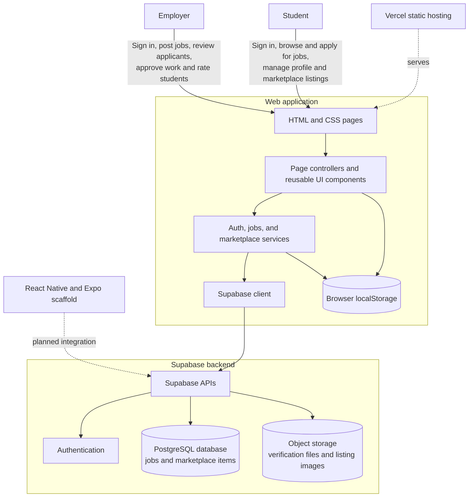
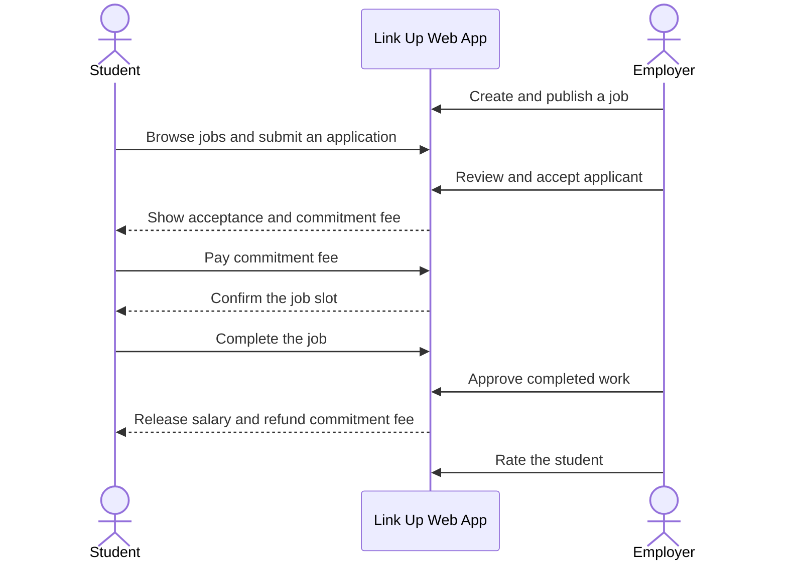

# 🔗 Link Up — Campus Side Hustle Platform

[](https://github.com/yourusername/link-up)
[](#-tech-stack)

**Earn & hire safely within your campus community.**

Link Up is a specialized platform designed to bridge the gap between students seeking side hustles and campus-based employers looking for reliable, short-term help. By integrating a unique **Commitment Fee** system, Link Up ensures trust and reduces no-shows, creating a professional environment for student services.

---

## 🚀 Key Features

### 🎓 For Students (The Hustlers)

- **Personalized Recommendations:** Get job suggestions based on your skills, interests, and campus location.
- **Unified Dashboard:** Track active jobs, pending applications, and earnings in one place.
- **Secure Gigs:** Use the "Commitment Fee" system to lock in jobs and demonstrate your reliability.
- **Earnings Tracking:** Monitor your monthly income, pending payments, and completed job history.
- **Marketplace:** List your own products or specialized services (Phase 2).

### 💼 For Employers (The Hirers)

- **Seamless Job Posting:** Create detailed job listings with specific categories, pay rates, and locations.
- **Applicant Management:** Review student profiles, skills, and portfolios before hiring.
- **Trust-Based Hiring:** The commitment fee ensures that hired students are serious about the task.
- **Payment & Rating:** Approve work completion to release payments and rate student performance to build the community's reputation.

---

## 🛡️ The Commitment Fee System

One of Link Up's core innovations is the **Commitment Fee**.

1. **Application:** Student applies for a job.
2. **Acceptance:** Employer reviews and accepts the student.
3. **Commitment:** The student pays a small, refundable commitment fee to secure the slot.
4. **Completion:** Once the job is finished and approved by the employer, the **salary is released** and the **commitment fee is refunded** to the student.

_This system significantly reduces no-shows and ensures both parties are committed to the gig._

---

## 💻 Tech Stack

Link Up is built with a focus on performance and simplicity using a modern Vanilla web stack:

- **Frontend:** HTML5, CSS3 (Modern Flexbox/Grid), JavaScript (ES6+ Modules).
- **Architecture:** Component-based CSS and modular JS services.
- **Design System:** Custom variables-based UI with a clean, professional aesthetic (using the `Link Up Blue` and `Link Up Green` brand palette).
- **Icons:** Custom SVG icons and font-based icons.

---

## 🏗️ System Architecture

The current MVP is a client-side application deployed as static assets on Vercel. Students and employers use the same web application through role-specific pages. Browser-side services use the Supabase JavaScript client for authentication and persistent data, while a few in-progress job and payment flows still use local browser storage.



The service modules provide the boundary between the UI and Supabase. This keeps authentication, job, and marketplace data access separate from rendering logic and provides a migration path for the mobile application.

### Core Job Journey



The sequence above represents the intended end-to-end commitment-fee workflow. Some job, application, and payment steps are currently simulated in browser storage in the MVP.

---

## 📂 Project Structure

```text
link-up/
├── assets/             # Images, fonts, and brand assets
├── css/
│   ├── base/           # Reset, typography, and global variables
│   ├── components/     # Reusable UI elements (buttons, cards, modals)
│   └── pages/          # Page-specific styling
├── js/
│   ├── components/     # UI component logic (modals, navbars)
│   ├── pages/          # Page-specific application logic
│   ├── services/       # API and data handling (Mock-based for MVP)
│   └── utils/          # DOM helpers and formatters
├── pages/
│   ├── auth/           # Login, Register, and Onboarding flows
│   ├── employer/       # Employer-specific home page and tools
│   └── student/        # Student-specific dashboards and tools
└── index.html          # Main landing page
```

---

## 🛠️ Getting Started

### Prerequisites

- Any modern web browser (Chrome, Firefox, Safari, Edge).
- A local development server (optional, but recommended for ES modules).

### Installation

1. Clone the repository:
   ```bash
   git clone https://github.com/yourusername/link-up.git
   ```
2. Navigate to the project directory:
   ```bash
   cd link-up
   ```
3. Open `index.html` in your browser. If using VS Code, we recommend the **Live Server** extension.

---

## 🗺️ Roadmap (Phase 2)

- [ ] **Backend Integration:** Replace mock data with a live Node.js/Firebase backend.
- [ ] **Real-time Notifications:** Alerts for job status changes and payment releases.
- [ ] **Marketplace Expansion:** Allow students to open digital "stalls" for products (food, crafts, etc.).
- [ ] **In-app Chat:** Direct communication between employers and students.
- [ ] **Mobile App:** Native mobile experience using Capacitor or PWA.

---

## 📄 License

This project is licensed under the MIT License - see the [LICENSE](LICENSE) file for details.

---

Developed with ❤️ for the campus community.
